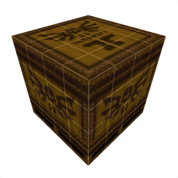

# Ultimate Trench Broom

An extended, unofficial fork of [TrenchBroom](https://github.com/TrenchBroom/TrenchBroom) for brush-based level design. The original editor, its history, and its GPL license remain the foundation of this project.

**[Windows v0.4 download](https://github.com/dragxnd/UltimateTrenchBroom/releases/tag/v0.4)** | **[Documentation](https://dragxnd.github.io/UltimateTrenchBroom/)** | [Documentation source](docs/index.html)

## What's New in This Fork

- **Terrain**: live procedural terrain, segment counts, noise, seed, height, generation side, triangular or square cells, and optional grouping.
- **Polygon Cut and Polygon Spawn**: draw closed outlines on a brush to cut geometry or build new brushes. Cut depth, keep-cutout mode, and cleaner convex decomposition are available.
- **Bevel**: multi-edge outer and inner bevels, segments, width, curvature, asymmetric proportions, optional retained offcuts, and a dedicated live settings panel.
- **Inset**: inset a single brush face, with an inner brush, border pieces, and grid-sized stepping.
- **Spin**: extrude selected faces along a controllable segmented path, with endpoint movement, rotation, scale, and flexibility.
- **Bezier Bend**: deform a group using adjustable curve handles, move/rotate/scale controls, an axis, and additional subdivisions.
- **Subdivision**: split brushes or groups by segment counts or grid dimensions, aligned to the world grid or a selected face's texture coordinates.
- **Subtract 2 and Convert Triang Brushes**: cleaner CSG results and per-brush cleanup of triangulated geometry.
- **Generate Rock**: seeded rock shapes, segment controls, optional hollow walls, and grouped output.
- **Sculpt**: raise, lower, and smooth brush vertices with a surface brush, shared-vertex handling, and a depth-protection option.
- **Array**: live random-radius, line/star, and concentric-ring placement, with seed, spacing, offsets, axis, orientation, and mirror-offset controls.
- **Symmetry**: 2/4/8-sided editing around one designated object, rotate mode, visible axes, related-object recovery, and paired undo.
- **Grid and coordinates**: rotated brush-face grids and snapping, automatic integer vertex snapping, and an editable XYZ overlay.
- **Prefabs and EntityList**: persistent named-group collections, detailed cached previews, drag-and-drop placement, unique names, search, and camera focus.
- **Material and Entity Browsers**: adjustable thumbnail sizes, Ctrl + wheel zoom, collapsible material groups, and texture refresh.
- **Texture Folders and Pallete**: PNG/JPG collections, export-palette selection and preview, and compile-time texture WAD generation.
- **Unity Sync**: geometry and aligned textures in one level prefab, optional separate brush children, adjustable root scale, and reuse of existing materials.
- **Quake preview**: editor lighting and sky preview, looping door/button/lift/train animation, live entity-property updates, and an intermission-camera preview.
- **Spawn Master**: configure triggered teleport spawns using a shared expandable monster closet.
- **Workflow improvements**: dynamic tool settings panels, live previews, Apply/Default controls, improved undo and Escape handling, Russian-layout movement, and native guide-screenshot capture.

Only visible, supported fork tools are documented. The experimental MCP bridge has been removed; hidden model import is not part of the supported v0.4 feature set.

## Getting Started

1. Download the Windows x64 archive from the release page.
2. Extract the entire archive and run `UltimateTrenchBroom.exe` inside `UltimateTrenchBroom`.
3. Configure your game and assets as in the original editor. Game data is not included.
4. Open the [visual guide](https://dragxnd.github.io/UltimateTrenchBroom/). An offline copy is included in `HELP/real-guide-en/index.html`.

Back up existing maps before using new geometry tools. This is an independently developed fork, not an official TrenchBroom release.

## Building the Fork

The build target remains `TrenchBroom`; the resulting application is named `UltimateTrenchBroom`. Version 0.4 is declared in the root `CMakeLists.txt`.

Clone this repository recursively and follow [BUILD.md](BUILD.md). The Windows release uses Qt 6.9.2 and an MSVC x64 toolchain. No local game folders, map files, or personal settings are required to build the editor.

## Contributors and License

- [dragxnd](https://github.com/dragxnd): fork maintainer, feature direction, workflow design, testing, and iteration.
- Kristian Duske and the [TrenchBroom contributors](https://github.com/TrenchBroom/TrenchBroom/graphs/contributors): original editor and infrastructure.
- Fork implementation was developed with assistance from OpenAI Codex.

The editor is distributed under [GPL-3.0-or-later](LICENSE.txt), retaining upstream copyright notices and third-party credits. The Windows release includes the license and dependency notices.

---

# Original TrenchBroom

TrenchBroom is a modern cross-platform level editor for Quake-engine based games.

- Trailer:   https://www.youtube.com/watch?v=shcAvnYp9ow
- Website:   https://github.com/TrenchBroom/TrenchBroom
- Discord:   https://discord.gg/WGf9uve
- Mastodon:  https://mastodon.gamedev.place/@trenchbroom
- Bluesky:   https://bsky.app/profile/trenchbroom.bsky.social
- Video Tutorial Series:  https://www.youtube.com/playlist?list=PLgDKRPte5Y0AZ_K_PZbWbgBAEt5xf74aE
- Manual:    https://trenchbroom.github.io/manual/latest

## Features
* **General**
  - Full support for editing in 3D and in up to three 2D views
  - High performance renderer with support for huge maps
  - Unlimited Undo and Redo
  - Macro-like command repetition
  - Issue browser with automatic quick fixes
  - Point file support
  - Automatic backups
  - .obj file export
  - Free and cross platform
* **Brush Editing**
  - Robust vertex editing with edge and face splitting and manipulating multiple vertices together
  - Clipping tool with two and three points
  - Scaling and shearing tools
  - CSG operations: merge, subtract, intersect
  - UV view for easy texture manipulations
  - Precise texture lock for all brush editing operations
  - Multiple material collections
* **Entity Editing**
  - Entity browser with drag and drop support
  - Support for FGD and DEF files for entity definitions
  - Mod support
  - Entity link visualization
  - Displays 3D models in the editor
  - Smart entity property editors
* **Supported Games**
  - Quake (Standard and Valve 220 file formats)
  - Quake 2
  - Quake 3 (partial, no patches or brush primitives yet)
  - Hexen 2
  - Daikatana
  - Generic (for custom engines)
  - More games can be supported with custom game configurations

## Releases

Binary builds are available from [releases](https://github.com/kduske/TrenchBroom/releases).

## Compiling

Read [BUILD.md](BUILD.md) for instructions.

# Contributing

See [CONTRIBUTING.md](CONTRIBUTING.md) for more information.

# Credits
- [Qt](https://www.qt.io/)
- [FreeType](https://www.freetype.org/)
- [FreeImage](https://freeimage.sourceforge.io/)
- [TinyXML](http://www.grinninglizard.com/tinyxml/)
- miniz
- [Assimp](https://www.assimp.org/)
- [Catch2](https://github.com/catchorg/Catch2)
- [CMake](https://cmake.org/)
- [vcpkg](https://www.vcpkg.io/)
- [Pandoc](https://www.pandoc.org/)
- Quake icons by [Th3 ProphetMan](https://www.deviantart.com/th3-prophetman)
- Hexen 2 icon by [thedoctor45](https://www.deviantart.com/thedoctor45)
- [Source Sans Pro](https://fonts.google.com/specimen/Source+Sans+Pro) font

## Changes

See [releases](https://github.com/TrenchBroom/TrenchBroom/releases) for latest changes.
